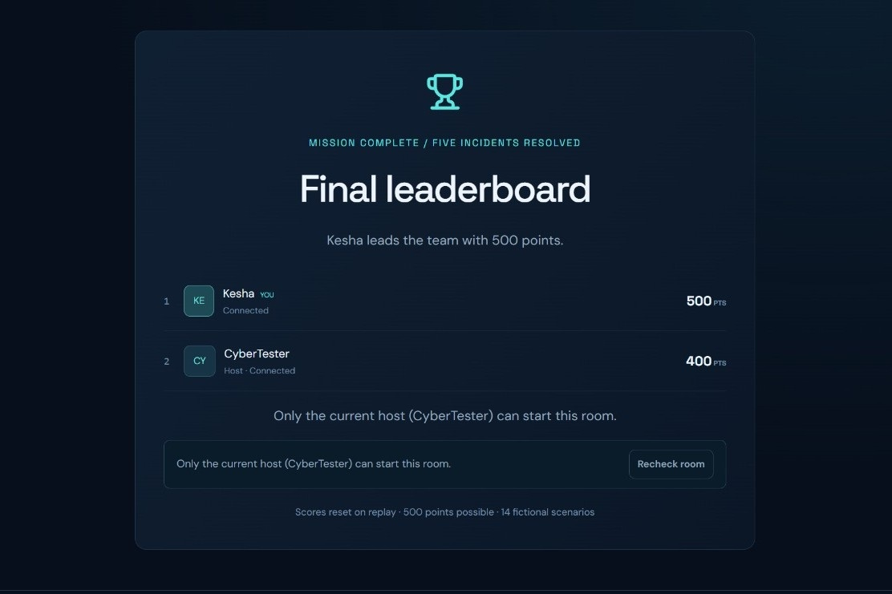

# CyberQuest AI — Multiplayer Cyber Incident Challenge

A browser-based multiplayer cybersecurity education game for 2–6 players. Built for the Handshake AI Skills Studio “Create a Multiplayer Game” challenge.

## Project Preview


## Play
Public game: https://cyberquest-ai-kesha.sunsettune17.chatgpt.site/

1. Open the public game URL, enter a nickname, and create a room.
2. Share the invitation link or six-character code. Friends join on their own devices or in separate browser profiles. Ordinary tabs in one browser profile share one player identity.
3. The host starts with at least two connected players.
4. Investigate five fictional incidents. Each question lasts 30 seconds. Select one of four answers and press **Lock answer**. Locked submissions cannot be changed.
5. Correct answers earn 100 points; incorrect or missing answers earn 0. Maximum: 500 points. Ties share a rank. There are no speed bonuses.
6. A 12-second synchronized debrief reveals the answer and explanation after each question. The final leaderboard appears after the fifth debrief.
7. The host selects **Play again in this room** for a new match with cleared scores.

Version 1 uses 14 predefined incidents, two for each category: phishing, suspicious logins, endpoint security, unauthorized access, network attacks, firewall/SIEM investigation, and ransomware. There is no AI API integration or generated incident content in this version. Scenarios simplify real incidents for learning and are entirely fictional.

## Stack

- React 19 and TypeScript UI
- Vinext / Vite with the supported Sites build integration
- Cloudflare Workers TypeScript API
- Cloudflare D1 shared database, schema migrations generated with Drizzle
- Approximately one-second HTTP polling; this is true shared multiplayer, not WebSockets or Socket.IO
- Lucide icons and responsive CSS

## Architecture and correctness

`app/page.tsx` renders the welcome, lobby, incident, debrief and final leaderboard. It never imports the scenario bank. `app/api/game/route.ts` authenticates anonymous sessions, validates input, rate limits requests and applies commands. `lib/game.ts` implements phase advancement and public state projection. `lib/scenarios.ts` is server-side content.

Each room is one bounded D1 record containing its roster, phase, deadline, match ID, five scenario IDs and locked answers. Every mutation executes an optimistic compare-and-swap:

```sql
UPDATE rooms SET data = ?, version = version + 1
WHERE code = ? AND version = ?;
```

Only one contender can update a version. Others reload, revalidate and retry (up to 16 attempts). Join capacity, host permissions, duplicate answers and transitions are rechecked against the fresh state. Answers include both match ID and round number, so stale requests cannot land in a later round or replay. Scores are derived from the unique locked answers instead of an incrementing score counter, preventing double awards.

The Worker sets the first deadline from its own timestamp. Subsequent deadlines advance from the previous deadline (30 seconds for questions, 12 seconds for debriefs). The browser estimates server clock offset and displays the remaining time; it has no authority over eligibility. Transitions are evaluated on requests, with no dependence on a host timer or an in-memory interval. If everyone disconnects, the next request catches up using the established deadlines. No scheduled Worker invocation is required.

Current-round answers and explanations are omitted until reveal. Scores during a question include only completed rounds. Client snapshots carry versions to prevent an older response from replacing newer state.

## Anonymous sessions and safeguards

- Random 256-bit session tokens in HttpOnly, SameSite=Strict cookies. Secure on HTTPS; the internal HTTP development preview omits Secure.
- Only SHA-256 token digests are stored in room state; raw tokens are not returned in JSON or stored in localStorage.
- Room codes are invitations, not authentication tokens. Only room members can retrieve state; only the current host can start.
- Nicknames: 2–20 Unicode letters/numbers, spaces, dots, underscores or dashes; case-insensitive uniqueness in a room. React escapes rendered names.
- 2 KiB request size limit, action validation, answer bounds, origin checking and no-store responses.
- D1-backed fixed-window IP request limits: 600 state reads and 90 commands per minute. These limits are shared by people on the same public IP. This is basic abuse resistance, not a replacement for upstream production WAF controls.
- Rooms expire 24 hours after creation. Expired rooms and rate-limit windows are cleaned up when a room is created.
- Disconnected players retain their seat until leaving or the next replay. Recently active means a heartbeat within 45 seconds; the UI labels gaps over 15 seconds as reconnecting. Host transfer occurs after 90 seconds of absence, or immediately after leaving. Before replay, disconnected players are removed; removed players can rejoin after the match.
- Browser cookies identify the player, not a registered account. Clearing cookies loses that identity. The remembered room code alone cannot restore it.

## Development

Requires Node.js >=22.13.0. The checked-in pnpm lockfile preserves dependency versions.

```sh
corepack enable
pnpm install --frozen-lockfile
npm run db:generate  # only after intentionally changing db/schema.ts
npm run build
```

Apply the existing initial migration to local D1 once (do not replay already applied migrations):

```sh
node --import ./scripts/sites-env.mjs ./node_modules/wrangler/bin/wrangler.js d1 execute DB --local --config dist/server/wrangler.json --persist-to .wrangler/state --file drizzle/0000_windy_madrox.sql
npm run dev
```

Follow the URL printed by the dev server. Hosted D1 is separate from local D1. To preview the built Worker locally, use `npm start` after migration. In managed Work environments, use the Sites-managed preview rather than launching an additional server.

## Tests

```sh
npm run typecheck
npm run test:client
npm run test:lobby
node tests/worker-harness.mjs
```

The harness runs the authored API and domain modules in the actual workerd/Miniflare runtime with a real local D1 binding and schema migration. It dispatches independent session requests without starting a preview web server. It uses the real 30-second / 12-second deadlines; allow about 3.5 minutes. It creates only isolated test data. `tests/results.json` captures completed checks.

To test a reachable deployment directly with independent HTTP cookie jars:

```sh
GAME_URL=https://YOUR-PUBLIC-GAME-URL node tests/integration.mjs
```

This creates real test rooms. Do not substitute private auth cookies. See TEST_RESULTS.md for exactly what was checked and verification limitations.

## Deployment

This project is configured for Sites-managed Cloudflare Workers and D1. `.openai/hosting.json` retains its Site identity and DB binding; do not reuse that project ID for an unrelated copy. The Sites workflow builds the Worker, provisions D1, applies schema migrations, pushes source and publishes a saved version. Set audience to **public** so guests do not need ChatGPT sign-in. The app does not call ChatGPT authentication helpers.

For independent Cloudflare hosting, supply your own Worker/D1 configuration and run the same generated migration before routing traffic. The supplied standalone `npm run build` produces the Worker assets; the managed hosting manifest is specific to Sites. A GitHub Pages-only deployment cannot host this backend.

## GitHub and portfolio

The export includes authored source, schema/migration, lockfile, build helpers, README and tests. It excludes node_modules, build output, local databases, environment files, credentials and runtime caches. Create your own GitHub repository and commit the exported project. Preserve the vendored Sites plugin license in `scripts/vite/`.

Suggested truthful portfolio description: “Built a React/TypeScript multiplayer cybersecurity game with a Cloudflare Workers/D1 backend, anonymous room sessions, server-authoritative deadlines and scoring, concurrency-safe updates, and 14 educational incident scenarios.”

Add a deployed link and screenshots after verifying the public game. Do not claim AI scenario generation or Socket.IO in v1.

## Lobby reliability fix

See BUGFIX_REPORT.md for reproduced failure cases and diagnostics. Lobby and replay controls always allow the host to request a fresh authoritative start check, rather than locking on an old online flag. A one-player request is still rejected by the server. Displayed presence ages even between snapshots. Returning focus, visibility or network connectivity triggers a resync; temporary network/5xx failures retain room membership with retry backoff. All requests (including response parsing) have an eight-second client deadline. A timed-out start is reconciled through state reads, and expected-match guards reject stale starts.

Structured Worker logs use request IDs, safe reason codes, host authorization booleans, active counts and heartbeat ages. They contain no cookies, raw tokens or player token digests. Client warnings likewise omit request bodies and identifiers.

Additional checks: `npm run test:client` (timeouts, transient errors, stale responses and presence display) and `npm run test:lobby` (real D1 regression fixtures, repeated independent sessions, refresh and replay). Lobby fixtures alter only an isolated temporary test database, never production. The optional baseline reproduction requires the original Git history.

`npm run test:fast` runs the same complete five-round workerd/D1 integration suite with an injected test clock. Only the harness wrapper controls that clock; the deployed handler has no test-clock headers or endpoints. `npm test` and live endpoint tests use real time. All raw concurrent-test response bodies are consumed to release transport resources.
